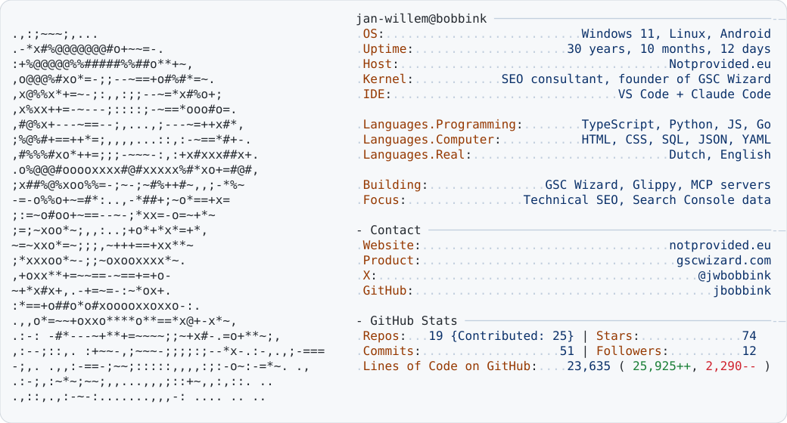

<a href="https://www.notprovided.eu">
  <picture>
    <source media="(prefers-color-scheme: dark)" srcset="dark_mode.svg">
    
  </picture>
</a>

<!--
  The card is rebuilt daily by .github/workflows/build.yml (scripts/update.mjs).
  Edit the text in profile.config.json; the portrait comes from scripts/make_ascii.py.
-->
